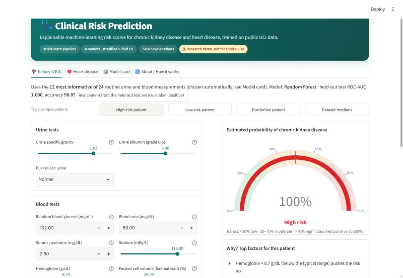
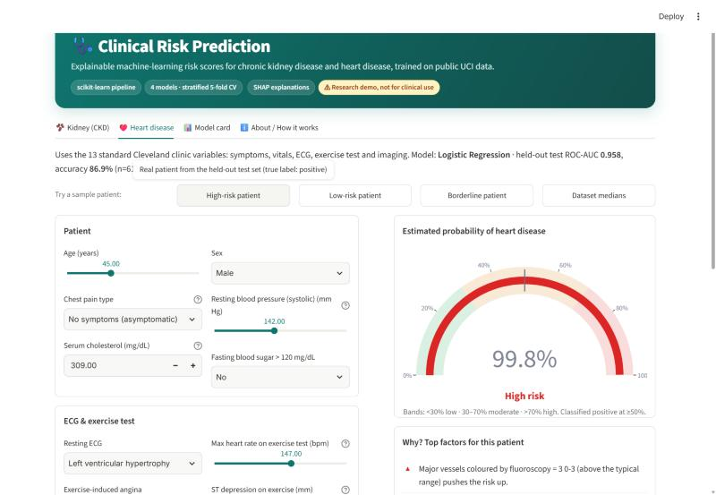
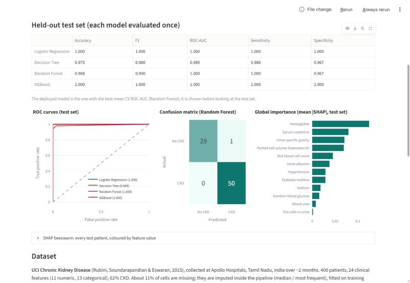
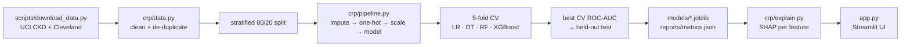

# Clinical Risk Prediction

Explainable risk scores for **chronic kidney disease** and **heart disease** from routine clinical data: one shared scikit-learn pipeline, four models compared with stratified 5-fold CV and a held-out test set, SHAP explanations and a Streamlit app.

> ⚠ Research demo, not for clinical use.



| Heart tab | Model card |
|---|---|
|  |  |

## Features
- **Two risk calculators** (Kidney, Heart) with grouped input forms: sliders and selects with units and typical reference ranges in the tooltips.
- **Risk gauge** (low / moderate / high bands) and the **top 5 SHAP factors for this patient** in plain language ("Hemoglobin = 8.7 g/dL (below the typical range) pushes the risk up").
- **Sample patients one click away**: real high-risk, low-risk and borderline patients from the held-out test set (`examples/`).
- **Model card tab**: CV and test metrics for all four models, ROC curves, confusion matrix, global SHAP importance and beeswarm, dataset description, leakage checks, limitations.
- Teal medical theme, Inter font, "research demo" disclaimer.

## Architecture


## Results (held-out 20% test set; CV = stratified 5-fold on the training split, mean ± std)

| Task | Deployed model (best CV ROC-AUC) | CV ROC-AUC | Test accuracy | Test F1 | Test ROC-AUC |
|---|---|---|---|---|---|
| CKD (UCI, 400 patients, 12 of 24 features) | Random Forest | 0.999 ± 0.002 | 0.988 | 0.990 | 1.000 |
| Heart disease (UCI Cleveland, 303 patients) | Logistic Regression | 0.907 ± 0.018 | 0.869 | 0.867 | 0.958 |

Full tables for all four models (LR, Decision Tree, Random Forest, XGBoost) are in `reports/metrics.json` and the app's **Model card** tab. Figures: `docs/figures/`.

**Why is CKD near 100%, and why is it not leakage?** The UCI CKD data is close to separable: a single threshold on hemoglobin alone gets ~91% CV accuracy and plain logistic regression reaches CV ROC-AUC ≈ 1.00. Checks: 0 test rows duplicate a training row; with shuffled labels CV ROC-AUC falls to 0.51 ± 0.05 (100 permutations, p = 0.01); imputation/scaling are fitted inside the CV pipeline; features were selected on the training split only. Caveat: 72% of CKD rows vs 23% of healthy rows have missing values, a collection artefact.

**Feature selection (CKD, 24 → 12):** Random-Forest permutation importance measured with log-loss on each CV validation fold of the training split, averaged; top 12 kept (hemo, sg, sc, pcv, htn, al, rbcc, dm, bgr, bu, sod, pc).

**Heart data:** the UCI Cleveland file is used, not the 1,025-row Kaggle version (≈300 patients duplicated ~3×, which leaks across random splits). Duplicates are removed before splitting regardless.

## Quick start
```bash
python -m venv .venv && .venv/Scripts/activate   # Windows; use bin/activate on macOS/Linux
pip install -r requirements.txt
python scripts/download_data.py                  # UCI data -> data/raw/
streamlit run app.py                              # trained models are already in models/
```
Retrain: `python -m crp.train` (slow on CPU: permutation tests). Tests: `python -m pytest -q`.

## Tech stack
Python 3.12 · scikit-learn · XGBoost · SHAP · pandas · Streamlit · Plotly · matplotlib

## Structure
`crp/features.py` feature metadata (units, reference ranges) · `crp/data.py` loading/cleaning · `crp/pipeline.py` impute → one-hot → scale → model · `crp/train.py` CV, selection, test, checks, figures · `crp/explain.py` SHAP mapped back to original features · `app.py` Streamlit UI.

## Data & credits
- Chronic Kidney Disease, UCI ML Repository (id 336), Rubini, Soundarapandian & Eswaran, 2015.
- Heart Disease, UCI ML Repository (id 45), Cleveland Clinic subset, Detrano et al., 1989.

## Author
Built by **Amna Choudhri**. MIT License.
